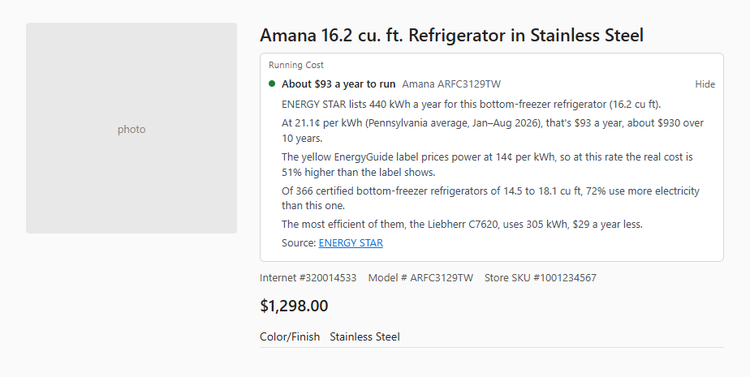
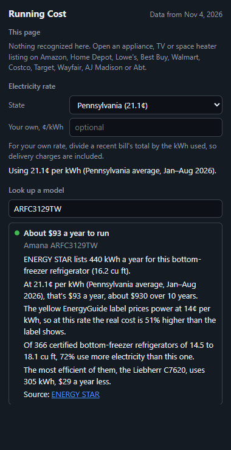

# Running Cost

A Chrome extension that shows what an appliance will cost to run at your electricity rate, on the store listing.



The yellow EnergyGuide label prices electricity at a national figure set by the FTC: 14¢ per kWh for appliances (since 2023) and 16¢ for TVs (since 2024). Real rates are nowhere near one number. The EIA's state averages for January to August 2026 run from 12.5¢ in North Dakota to 32.6¢ in California and 46.4¢ in Hawaii, and Pennsylvania's went up 12% on the year before. So the label is off by half or more for a lot of people, and it says nothing about how a model compares with the others its size.

## What it shows

On a product page it finds the model number, looks it up in ENERGY STAR's list of certified models, and puts a short panel under the title:

- the yearly cost at your rate, and roughly what that adds up to over 10 years
- how far off the yellow label's figure is at your rate
- how the model compares with certified models of the same kind and a similar size, and what the most efficient one would save

It covers refrigerators, freezers, dishwashers, washers and all-in-one washer-dryers, electric dryers, window and wall air conditioners, dehumidifiers, TVs, heat pump water heaters and air purifiers (about 9,600 models).

Two fallbacks cover listings that aren't on ENERGY STAR's list:

- If the store's spec table gives the yearly kWh ("Annual Energy Consumption (kWh/year) 650"), it uses that.
- For electric space heaters it reads the wattage from the title and gives the cost per hour and per month.

It runs on Amazon, Home Depot, Lowe's, Best Buy, Walmart, Costco, Target, Wayfair, AJ Madison and Abt. The panel always names the model it matched, so you can tell when it guessed wrong. The toolbar badge shows the yearly cost for the page you're on.



The rate is your state's average residential price from the EIA, or your own: divide a recent bill's total by the kWh used, so delivery charges are counted. The popup also has a box for looking up a model number by hand.

Everything runs locally. The data ships with the extension, there's no server, and the only permission is `storage`.

## How matching works

- **Where the model number comes from.** In order: a UPC or GTIN in the page's product data, the model or MPN in that data, text labelled "Model #", "Item model number", "Part number" and so on, then model-like words in the title. A model number from the title only counts if the brand is in the title too.
- **ENERGY STAR's wildcards.** ENERGY STAR lists model families, like `WRS325SDH*` for the colour variants of one refrigerator, `GDE21DMK****`, or `MFI2568AE(W/S/B)`. Each wildcard matches one character or none, and a trailing one also allows a short revision suffix. Spaces, dashes and region codes (`DV45K7100GW/A2`) are ignored.
- **Comparisons** use certified models of the same type (bottom-freezer refrigerators, front-load washers, window air conditioners) within 12% of the size, or 25% when that finds fewer than eight.

## Install

Not on the Chrome Web Store yet. To load it:

1. Clone this repo.
2. Open `chrome://extensions` and turn on Developer mode.
3. Click **Load unpacked** and pick the repo folder.

## Development

```bash
npm test              # unit tests (Node 20+, no dependencies)
npm run e2e           # loads the extension into headless Chrome against stand-in store pages
npm run data          # re-downloads the ENERGY STAR lists and EIA prices into data/
```

`npm run e2e -- --screenshots docs` regenerates the screenshots above. A weekly GitHub workflow runs `npm run data` and commits any changes.

## Not covered yet

- Models that aren't ENERGY STAR certified and whose listing doesn't state the yearly kWh. The DOE's certification database covers every model and would close most of this gap, but it has no download I could use.
- Gas dryers and gas water heaters. Their figures mix gas and electricity, which can't be priced at an electric rate.
- Canadian prices. The Canadian stores work, but enter your own rate.
- Store layouts change. The model number is found the same way everywhere; the title selectors are in `src/content/sites.js`.

## License

MIT
